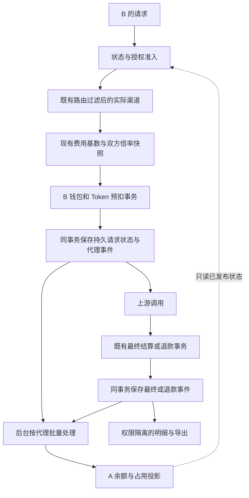

# 代理分销与用户专属倍率架构设计

## 系统边界与状态

本设计待实施。业务权限、流程及验收口径唯一引用[产品设计](../10-product/代理分销与用户专属倍率产品设计.md)；架构决策理由见 [ADR-0003](decisions/0003-代理额度异步记账与用户专属倍率.md)，技术工作包见[实施方案](../80-dev/2026-11-03-代理分销与用户专属倍率实施方案.md)，执行和实测状态唯一见[阶段实施计划](../50-planning/2026-11-03-代理分销阶段实施计划.md)。本文定义技术实现合同，不代表以下新表、新接口或性能已经存在。

代理是独立业务域，复用 `User` 身份及钱包结算基础，不复用组织成员关系、邀请奖励余额或组织 Invoice 作为采购总账。直属普通用户保持原访问规则；用户专属倍率独立于代理身份，可用于普通用户。一级固定归属、专用代理账户，不承担实际资金业务。

## 当前代码事实

以下是读取当前工作树后的接线依据，不是对未覆盖路径的完成声明：

| 入口 | 已有职责 | 新能力的最小接触面 |
|---|---|---|
| `model/billing_balance.go` | B 钱包及 Token 的事务预扣、补预扣 | 原事务内追加持久计费状态与代理事件；代理客户强制钱包、严格检查追加预扣 |
| `service/billing_session.go` | 预扣、Reserve、结算、退款及请求会话状态 | 携带专属计价快照和原始基数；接入持久预扣恢复；代理客户不能使用跳过实际预扣的信任旁路 |
| `service/billing.go` | 最终消费及任务提交统一入口 | 最终消费确认与任务暂扣分类；同步记录共同基数及双方额度 |
| `model/task_settlement.go` | journal 的资金、Token、任务额度及 Applied 事务 | 同事务追加结算事件与持久去重凭据；不在此逐笔更新 A 余额 |
| `service/billing_recovery.go` | journal 恢复、日志 outbox、完成后清理 journal | 使用同一恢复入口；清理不得删除代理事实或去重凭据 |
| `service/task_billing.go`、`service/task_polling.go` | 任务补结算、失败和超时退款 | 捕获最终确认、零差额完成和退款，不重写插件的成功失败判断 |
| `model/organization_invoice_task_expense.go` | 已有任务最终费用确认，包含零差额完成路径 | 定位实际完成接线点；新增代理状态独立，不能把 Invoice 回写口径直接当采购流水 |
| `service/organization_discount_request.go`、`types/price_data.go` | 请求内组织倍率快照及预扣目标 | 保持原规则，专属倍率在现有费用结果外独立应用；不复用组织快照承载用户授权 |
| `model/ability.go`、`service/channel_select.go` | 分组、模型、渠道候选及优先级、权重、重试 | 以有效授权过滤候选，含缓存与数据库路径、指定渠道、亲和渠道和重试 |
| `model/user_quota_adjustment.go`、`controller/user_quota.go` | 管理员调额与不可变流水 | 复用原子调额思想；新增代理业务入口，旧入口拒绝直接调整 B |
| `service/authz/` | 管理资源能力；resolver 存在超级管理员放行 | 新增代理资源权限，并在领域层验证账号类型和归属，不能只依赖 Can |
| `model/auth_flow.go`、`model/twofa_enrollment.go`、`model/user_session.go` | 单次安全流程、MFA、会话版本 | 邮件激活、强制安全补齐、邮箱变更及恢复流程接入 |

现有结算部分路径允许预估外补扣形成欠额，不得把它描述成严格不透支。新策略要求 B 发送前按实际渠道折后额度准入、重试不足不发送，但不另写完整用量预测算法。

## 当前设计

### 模块职责

新增专用代理领域文件负责身份、归属、授权、倍率、额度调整、事件处理和报表；独立 Router / Controller / Service / Model 分层。现有文件仅接入必要调用、字段和注册，不扩写用户管理控制器承担代理全部业务，不重构既有结算算法以求复用。

复用原计费流程负责标准费用和 B 资金；新增“专属计价上下文”保存共同基数及双方映射；新增持久代理事件负责 A 账的输入。A 的余额是事件和人工调额的可重建投影，不能成为 B 每次扣款事务中的更新行。

### 数据模型

下表为拟定领域模型；具体表名、字段类型及索引在实现前随迁移评审固定。普通账号以无代理身份保持既有行为，不能把所有存量账号迁为代理客户。

| 模型 | 主要字段与不变式 |
|---|---|
| 代理账户 | `user_id` 唯一、资格状态、已结算采购余额、处理中占用、发布版本及处理时间；资格停用独立于余额不足 |
| 代理客户关系 | `customer_user_id` 唯一、`agent_user_id`、激活状态、代理侧停用、创建时间；归属不可修改，无删除接口 |
| 模型渠道授权 | 主体、精确计费模型名、渠道 ID、显式授权状态；组合唯一；可保存当前被上级屏蔽的客户授权 |
| 用户专属倍率及历史 | 用户、模型、渠道、六位定点倍率、修订标识、操作者和时间；编辑乐观锁；历史不可改写 |
| 额度调整流水 | 唯一操作标识、账户类别、对象、操作人、原因、正负额度、前后余额、业务时间；无实收金额字段 |
| 请求计费持久状态 | 请求/任务标识、计价快照、生命周期版本、占用目标、最终双方额度、原交易关联；支撑预扣崩溃恢复和 journal 清理后去重 |
| 代理记账事件 | 唯一操作标识、请求及生命周期版本、A/B、模型/实际渠道、基数、双方目标额度、占用与支出变化、发生时间、入账状态 |

模型渠道键使用当前计费名和稳定渠道 ID，不能用可变渠道名称作主键。读取配置时查找精确匹配，不用前缀、模糊或通配符。保留配置不代表能对已删除或失效渠道发起调用。

额度以现有 quota 精度存储，定点倍率以 `1_000_000` 缩放，允许整数 `1..2_000_000`。数据库存整数，不使用浮点累加余额。组合唯一索引与字符串长度必须验证 MySQL 最小版本的索引容量，不默认长模型名可在所有字符集下直接建联合索引；需要摘要键时保留原文并校验完整键相等，不能靠截断实现唯一。

权限和倍率保存修订历史，可由请求保存相关项的值及修订标识，不要求每个请求复制全平台完整矩阵。激活邮件、密码、TOTP 密钥或恢复码不得进入计价快照。

## 数据与控制流

后台消费器不是外部消息队列的强依赖。主库持久事件为事实，进程通知只能加速，通知丢失可由扫描补齐。代理请求不等待消费器追平，不同步争抢 A 的汇总行。

### 请求身份与授权

1. 身份由服务端读取，不接受客户端指定 A 或账单归属。A 的管理令牌不得变成个人消费令牌。
2. 对 B 计算 `有效授权 = A 当前授权 ∩ B 保存授权 ∩ 原路由候选范围`。Token 模型限制、分组和渠道启用条件继续生效。
3. 缓存与数据库路由都使用同一约束；显式渠道、亲和选择、自动分组、重试、任务提交等不得绕过。
4. 请求准入固定授权与倍率修订；后续尝试只从准入授权内选取，并保持既有分组刷新行为。新请求读取最新修订，配置缓存应版本化并在变更时失效，不以长时间缓存掩盖撤权。
5. 收回 A 授权不删除 B 配置，恢复同一项后重新生效；新增项不为 B 自动新增行。保存 B 配置时校验归属、上级当前授权及乐观锁。

路由算法不改变，但可选集合新增授权约束。“倍率不影响路由”不等于“授权不能过滤渠道”。运营可自行统一 `default`，代码不能强制或假设这一配置。

### 共同基数和独立倍率

`Q` 定义为本次 B 请求在原引擎完成表达式/按次/旧倍率计算，并应用现有分组、渠道、组织等因素后的费用，尚未应用用户专属倍率。只执行一次原引擎，保存基数，分别计算 `QB = Q × rB`、`QA = Q × rA`。

- `Q` 必须是实际参与本次扣费的基数；禁止后台从已舍入 `QB / rB` 或日志金额反推。
- 新层对原计费结果应用倍率；倍率为 `1` 时必须保持既有舍入结果。以各原路径已有额度规则为基础，使用 `common.QuotaFrom*Checked` / `QuotaRoundChecked` 等统一安全入口，不引入裸转换和新的本地舍入器。
- 最终保存双方整数目标额度；补结算采用“新累计目标－原累计目标”，全退精确冲回原记录。部分退款以原快照的剩余费用目标计算差额，禁止每一小笔各自舍入导致累计多退或少退。
- A 可以负余额、计费差额可以为负，不代表单笔采购支出或消费可为负；负向冲销必须标识退款、关联原操作并检查累计上限。
- 基础费用为零时沿用原引擎语义，倍率正数不意味着每笔强制最小扣一单位。
- 饱和、NaN、无穷值与溢出按 `.agents/rules/billing.md` 阻断或审计；不得以当前配置损坏时默认为 `1` 掩盖错误。确实未配置才取 `1`。

普通用户只应用自己的倍率，不生成代理采购分录。代理客户强制钱包，不进入订阅选择。没有修改表达式语言或插件计量合同的需求，主机新增专属计价层不得重复乘入 `OtherRatios`。

### 预扣与渠道重试

代理客户先取得实际候选渠道，以该渠道的专属倍率算 B 预扣；不能先按原价拒绝再在结算时折扣。现有组织保守预扣等语义不被本功能顺带重写，需要在旧入口顺序上确认能区分既有预扣基数和新增专属倍率。

代理客户禁用钱包信任旁路；B 钱包及受限 Token 必须覆盖发送前预扣。新渠道预估目标更高时，原子补足 B 和 Token 后再发送；不足则不执行该尝试，退出并沿原资金路径完成退款。更低目标可以沿原流程到最终结算释放，不能在重试时重复退款。

A 的预估占用通过事件异步反映渠道切换及目标变化，不同步预留代理主余额。上游提交前 B 的扣额、请求状态和代理事件必须一起持久化。

### 生命周期与事件合同

事件类型使用 `reserve`（预扣及占用调整）、`settle`（最终确认或显式补结算）、`refund`（释放占用或已结算冲销）。这是新增代理合同，不把现有 journal 的同名 `settle` 无条件视为最终完成。

每个事件具有稳定操作 ID、同请求递增生命周期版本、原操作关联、业务发生时间及目标状态。采用至少一次投递和幂等应用；同一操作重放不重复改 B、占用或 A，journal 删除后仍由持久状态和唯一凭据防重复。

| 阶段 | B 的资金事实 | 代理状态 |
|---|---|---|
| 首次或追加预扣 | 原子扣除或增加暂扣 | `reserve`：占用变为新的采购预估目标 |
| 异步任务提交 | 可能已有消费型日志及暂扣 | 保持占用，不能仅因提交 journal 或日志为消费就记采购支出 |
| 最终确认 | 按实际目标多退少补 | `settle`：占用归零，采购及客户消费成为最终累计目标 |
| 最终费用等于预扣 | 余额差额为零 | 仍发 `settle`，释放占用并确认支出 |
| 预扣失败退款 | B 资金退款成功 | `refund`：占用归零，不产生采购支出 |
| 已结算后退款 | B 实际资金冲回成功 | `refund`：按原交易减少最终累计采购和客户消费 |
| 恢复中 | 原资金事实尚未应用成功 | 不生成已成功的代理效果；保留恢复意图 |

同请求事件必须按生命周期顺序应用，或以持久最新目标产生等价的有序差额，不允许先释放后又回放旧预扣形成永久占用。重复或迟到终态由原请求/任务状态与原资金操作的唯一凭据裁决，代理层不自行复活已退款任务。

超时、断流、失败与用量判断由原引擎负责。普通请求预扣后进程崩溃的恢复需要持久请求状态支持；无结算记录不等于可以按时间自动退款，应区分尚未发送、已发送待判断和已确认资金意图。该路径必须在实施中给出恢复证明，不能只接入任务退款就宣称闭环。

### 事务与批量处理

主库事务分为两个边界：

1. **请求资金事务**：B 钱包、Token、必要任务/请求状态、代理事件、持久幂等凭据一起提交。事件持久化失败则该资金事务回滚；这是必要记账失败，不是后台积压停用。
2. **代理批量事务**：有界批次锁定待处理事件，按请求顺序计算变化，更新 A 汇总余额与占用，标记事件入账及发布版本，一起提交。失败整批回滚可重试。

同一代理批次之间可串行，同一代理各请求写入不同事件行。消费者可先单实例有界批处理，扩展多实例时使用可恢复的数据库任务领取/租约，不能依赖进程锁保证资金正确。不得依赖 MySQL 8 独有 `SKIP LOCKED` 作为正确性基础。

不以全局“最大自增 ID”直接充当已处理水位：并发事务可能先取得小 ID 后提交，较大 ID 先可见，单向越过会永久漏账。以持久待处理状态/收据扫描和请求生命周期依赖保证不遗漏、不乱序，配合索引与有界分页。

管理员调整 A 额度与消费器发布都属于 A 账户变更，必须使用同一原子更新纪律；不得读旧余额覆盖新值。人工调额即时提交并发出缓存失效，不等待消费器。消费日志库、ClickHouse 或 CSV 写入不能与主库资金假装处于一个分布式事务。

### 准入、缓存和可用性

`已发布可用额度 = 已结算采购余额 − 处理中占用`。准入读已发布状态，已知不足阻止新请求；补额或退款发布后恢复。账务新鲜度不是停用条件，允许在陈旧正余额下继续调用；跨实例状态传播也允许短暂超用。

A 停用、B 平台停用、B 代理侧停用、A 余额不足分别保存和判定。额度不足不注销登录；资格停用禁止 A 登录并停止全体客户新调用。恢复上级不清除客户自身限制。

缓存只加速，不作为额度或计价唯一事实。缓存不可用时可读取主库已发布状态，不新增“账务超过 N 秒则拒绝”的降级。用户/权限未知、配置损坏、主库不可用等安全或必要记账故障与允许的消费器积压不同，不能无条件放行。

## 账户安全与管理接口

复用现有认证框架、会话和 `AuthFlow`，新增安全补齐策略及开户用途，不另建密码库。安全完成状态至少区分验证邮箱和已启用 TOTP，不能仅检查 `email != ''`。

- 所有用户及现有会话在普通后台接口受安全补齐限制；允许的端点按具体用途列白名单，不按整段 `/user/*` 放行。公开 API Key 调用与后台管理令牌/PAT 分类，不能借 PAT 绕过后台限制。
- OAuth、OIDC、Passkey、邮件恢复等成功认证不得跳过本地安全完成条件；保留现有登录方式，不把其他入口关闭当成永久防线。完成激活/认证权限提升时轮换会话。
- 激活、邮箱变更、MFA 设置与恢复令牌短时、单次、绑定用户和用途，服务端核验；重发或修改待激活邮箱使旧流程失效。
- 恢复码仅存安全散列、一次使用；TOTP 密钥等秘密按适用存储安全要求保护，禁止进入审计。安全操作实施前核对当前密码和因素存储，不宣称现状合规。
- 敏感变更使用近期重新认证及适用 MFA；采用会话认证的管理写操作实施 CSRF 防护，登录/邮件/恢复/MFA 验证有速率限制、重放保护和枚举防护。
- MFA 恢复撤销浏览器会话但默认保留 API Key；必须检查当前 `AuthVersion` 等失效机制是否把二者耦合，必要时隔离接入，不能为简化实现误撤销 Key。
- 人工恢复需要平台管理员独立能力、核验记录及通知；不会赋予 A 身份管理权。上线前制定核验依据与审计责任，普通资料编辑不能重置 MFA。

以查询范围和领域校验共同限制 IDOR。管理员通用编辑、调额、充值补单、角色修改、删除及批量接口不能变更 B 的额度、归属、授权、倍率或抹除财务事实。新建 B 与固定归属同事务；A 的资源能力不能授予系统管理权限。

拟新增接口按三类隔离：平台代理管理、代理当前身份管理名下客户、用户自有倍率展示/历史及激活安全流程。前端不提交可覆盖的 `agent_id` 决定权限。具体 URL、DTO、错误码在实现时按现有注册方式确定，不能在本方案伪称已有接口。

### S0 冻结的技术合同

以下为 2026-11-03 源码核对后的目标合同，尚无对应代理业务实现；S1–S3 依此接线，不能当作现存接口调用。现有接口维持原返回合同，新代理接口使用现有 `success/message/data` 外壳并返回稳定业务 `code`。

| 合同 | 固定规则 |
|---|---|
| 主体 | 服务端判定 `ordinary/agent/agent_customer`，新增接口不接受请求体覆盖主体归属；调用用户仍为 B |
| 精确配置键 | `OriginModelName` 的现有对外计费标识＋实际执行 `channel_id`，不重新按上游映射或自建规范化规则匹配 |
| 倍率输入 | 十进制字符串，最多六位小数，存缩放整数 `1..2000000`；未配置为 1000000；字符串避免客户端浮点误差 |
| 共同基数 | 原路径在专属倍率之前已经形成的整数 quota，记 `base_quota`；分别用十进制定点乘积和 `common.QuotaFromDecimalChecked` 得到双方目标，倍率 1 不改变原整数结果；不倒推、不二次执行价格引擎 |
| 部分退款 | 使用原基数的剩余累计目标，计算原快照双方新目标，再减持久旧目标；完整冲销严格使用原目标，累计退款不能超过原交易 |
| 配置保存 | 单用户、`expected_revision`、显式授权项及倍率项；409 冲突不覆盖，返回当前修订供重新读取；不允许跨客户混合 payload |
| 调额输入 | `operation_id`、`mode=add/subtract`、正整数 `quota`、非空 `reason`；无 override，同 ID 同参数返回原回执，不同参数 409 |
| 资金操作 ID | 请求的稳定 ID＋语义操作＋持久生命周期版本；任务使用稳定内部任务身份；不能把客户端上游 request-id 当唯一资金键，不能依赖临时 journal 长期去重 |
| 事件 | `reserve/settle/refund`，含 A/B、模型、实际渠道、快照、双方累计目标及原操作关联；同请求按版本处理，无全局最大自增 ID 跳过未提交事件 |
| 时间 | `occurred_at` 为该资金效果首次成功应用时在事务内固定的业务时间；意图创建、任务生成完成和后台 `processed_at` 单独保存。重试不刷新发生时间，退款用自身时间 |
| 页面状态 | 激活、各层停用、调用受限原因、业务结算、代理入账分别返回；最终未知额度为空，最终已确认零费用为 0 |
| 分页导出 | 服务端归属范围、半开业务时间区间、固定截止、发布修订/更新时间；内部键集游标基于稳定排序，不能仅用页码遍历不断变化的全表 |

新增管理错误固定：400 参数无效，403 身份/能力不允许，404 非名下或不可见资源（不泄露跨代理存在性），409 修订/操作幂等冲突或余额变更冲突，429 安全验证限流，503 必要持久化不可用；`code` 区分原因，消息支持既有 i18n。调用不足沿现有 relay 403/错误封装，后台积压和待入账不能映射为 503 或新增停用原因。

新接口族固定在 `/api/reseller/admin/agents`（平台代理管理）、`/api/reseller/self/customers`（A 当前身份下的单客户资源）及 `/api/reseller/self/billing`（A 账单查询/导出）之下；用户自有倍率显示使用独立只读入口。具体资源子路径随 API 实现登记，但不得挪用旧通用用户端点改变语义。所有新客户创建和普通资料接口均使用字段白名单，不能直接绑定完整 User 更新。

源码显示 `PrepareRequestBilling` 在 controller 重试选渠道之前执行，且原路径可先做保守预扣；要实现实际渠道折后准入，需要在新专属接线中分离“估价/冻结”与“实际预扣”。不能仅在 `PostTextConsumeQuota` 乘倍率，也不能在已按原价拒绝后补救；S3 必须回归组织倍率、自动分组和免费初始组的重试，保持既有普通用户语义。

普通钱包预扣没有请求收据；S1 的请求状态必须可表示“已预扣、发送结果未知、待最终确认、已最终确认、退款”，S4 在原资金事务内写入。崩溃后未见结果不证明上游未执行，不自动重发或按固定时间退款；保留待诊断事实，跟随原有明确结算/退款意图恢复。零差额完成仍需持久事件。

## 展示、查询与留存

### 前端身份与路由接线

界面布局与操作合同引用产品设计的“页面与导出”章节。以下为源码核对后的技术接线约束，不是已完成的 UI 实现：

- `web/src/hooks/use-sidebar-data.ts`、`use-sidebar-view.ts` 当前主要按系统角色与导航配置组装菜单；新增代理业务身份/能力分支，A 不通过提高系统角色取得导航。侧栏、直接 URL、页面数据查询和后端领域授权共同执行边界。
- `web/src/components/layout/lib/sidebar-view-registry.ts` 已支持嵌套工作区，可用于代理上下文；嵌套视图不经过全部根导航过滤，必须有独立路由准入，不能仅注册菜单。
- `web/src/routes/_authenticated/route.tsx` 已有登录会话守卫；在现有认证解析之后接入安全完成及业务身份守卫，保留激活/恢复白名单，避免重定向循环。安全状态未确定前不启动普通页面的查询。
- 原用户列表、编辑抽屉与行操作包含通用管理行为，不能直接作为 A 的客户管理。客户 feature 使用名下专用查询和 DTO；管理员查看 B 时也按领域能力收窄额度、订阅、删除、角色和安全重置操作。
- `features/wallet/index.tsx` 在页面层初始化充值、订阅和奖励相关 Hook；B 应在父层选择只读额度视图或兼容的受限组合，避免仅隐藏卡片却继续请求支付数据。直属普通用户保持原流程。
- `features/security/index.tsx` 包含访问令牌和自助删除；`two-fa-card.tsx` 包含关闭 MFA。补齐页只组合允许的安全步骤，正常安全中心按策略收窄动作，不能以完整页面复用绕过限制。

新增代理 feature 持有业务页面、列定义、详情页签和专用表单；现有布局、表格、抽屉、确认和状态组件继续作为公共能力。通用组件不能承担代理鉴权或自行请求代理业务数据。

### 状态与请求边界

前端分别接收账号激活、平台停用、代理侧停用、调用受限原因、业务结算状态和代理入账状态，不能压成一个 `status`。处理中与待入账是两个正交维度；未产生最终费用可为空，最终零费用则明确为零，不能使用同一默认值混淆。

列表和明细查询键至少隔离业务身份、代理/客户、筛选与页码；倍率查询额外隔离用户和配置修订。账号切换或权限变化需清理相应私有缓存，匿名模型广场不复用登录用户响应。A 页面不启动原个人钱包、消费 Key 或组织查询来决定代理权限。

授权及倍率草稿绑定具体 B 和修订，提交校验同一客户的授权与倍率一致性；修改客户后不能把上一客户草稿提交到新客户。额度提交用唯一操作凭据去重，前端按钮防连点不能替代后端幂等。变更成功刷新对应客户数据与历史，不因 B 加额乐观扣减 A 采购余额。

账单定时刷新仅在相应页面可见时按查询库机制进行，避免全后台高频轮询。刷新失败保留旧数据并标记获取失败，不能把旧余额改成零；账务积压只显示信息，不触发重定向或调用停用。页面状态定义、DTO 字段和导出投影共用合同。

### 事实展示与留存

代理专用报表从主库持久事实及发布投影生成，不依赖可清理的 `Log` 或临时 journal。B 继续使用原日志，新加专属倍率事实；异步任务原日志时间不一定等于代理最终消费时间，界面需解释暂扣与最终确认，不能伪造两者完全同账期。

为 A/B 分别建立明确 DTO 白名单：A 不含正文、密钥、认证秘密；B 不含渠道 ID/名称/类型、采购倍率或可还原渠道的嵌套字段。分页、详情、错误、历史、模型广场、CSV、Token 查询和任务状态出口一起验证，不仅删除前端列。

模型广场服务端返回按本人有效渠道聚合的倍率范围，包含未配置的 `1`；B 无权通过此接口取得原始配置矩阵。同模型多渠道变更历史按模型聚合，可显示范围前后值和操作者时间，但不返回渠道项。未登录请求不能命中带私有倍率的共享缓存。

导出固定查询条件、业务时间截止及可见性快照，返回发布版本/更新时间和待入账状态，按键集分页有界流式读取。新事件后到允许产生新账单版本，但不改写消费/退款发生时间；不把执行时间以前都宣称已完整入账。按北京时间解释日期筛选、使用半开区间，这是沿用现有账单的一致性设计。

原始代理事件、额度流水和完成收据不随普通日志 TTL 或 journal 清理删除。不在一期提供自动财务事实删除；长期归档容量策略需保留可重建与审计能力，不能通过关闭事件写入缓解积压。

## 约束与取舍

- 单代理 500 QPS 的主要聚合热点只出现在后台批次，不出现在 A 的逐请求扣款；B 自身高并发仍有原钱包热点。
- 不使用代理额度池、Redis 独立资金账、逐请求双账户同步扣款或因积压自动拒绝。代价是 A 超用无固定上限。
- 正常约一秒处理是待压测目标；性能瓶颈用批量、索引和查询隔离改善，不能通过牺牲持久化、幂等或业务可用性掩盖。
- SQLite 必须保证功能正确，但单写者结构不能据此承诺持续 500 QPS；目标部署的容量需在真实配置上证明。
- 同时支持 SQLite、MySQL >= 5.7.8、PostgreSQL >= 9.6；事务锁使用 `lockForUpdate(tx)`，不引入无三库替代的 SQL、JSON 类型或索引。
- JSON 使用 `common.*`；不要求 `relaykit/` 依赖宿主代理模型。若修改独立模块公开 API，仍单独构建验证。

## 安全依据与验证策略

2026-11-03 核对 OWASP 官方当前稳定入口为 [ASVS 5.0.0](https://asvs.owasp.org/)。采用其认证、会话、授权、秘密保护和安全日志要求作为实施核对基线；具体 requirement ID 必须在安全工作包中逐项核对并记录，本文不虚构条款映射、不声明已合规。

适用官方指南：[Authentication](https://cheatsheetseries.owasp.org/cheatsheets/Authentication_Cheat_Sheet.html)、[Session Management](https://cheatsheetseries.owasp.org/cheatsheets/Session_Management_Cheat_Sheet.html)、[MFA](https://cheatsheetseries.owasp.org/cheatsheets/Multifactor_Authentication_Cheat_Sheet.html)、[Forgot Password](https://cheatsheetseries.owasp.org/cheatsheets/Forgot_Password_Cheat_Sheet.html)、[CSRF](https://cheatsheetseries.owasp.org/cheatsheets/Cross-Site_Request_Forgery_Prevention_Cheat_Sheet.html)。实现密码设置、存储时另核对 [Password Storage](https://cheatsheetseries.owasp.org/cheatsheets/Password_Storage_Cheat_Sheet.html)，涉及 OAuth/OIDC 变更时核对对应指南。

验证围绕真实行为：共同基数守恒、完整退款精确归零、无占用泄漏、重复/乱序恢复、请求预扣崩溃、零差额任务完成、渠道重试、授权撤销恢复、旧接口绕过、后台安全限制与 Key 连续调用、页面导出脱敏、三库新建升级幂等及持续负载。实施方案说明技术验证方法，阶段实施计划维护实际命令、环境版本和结果，不以设计通过代替实现验证。
