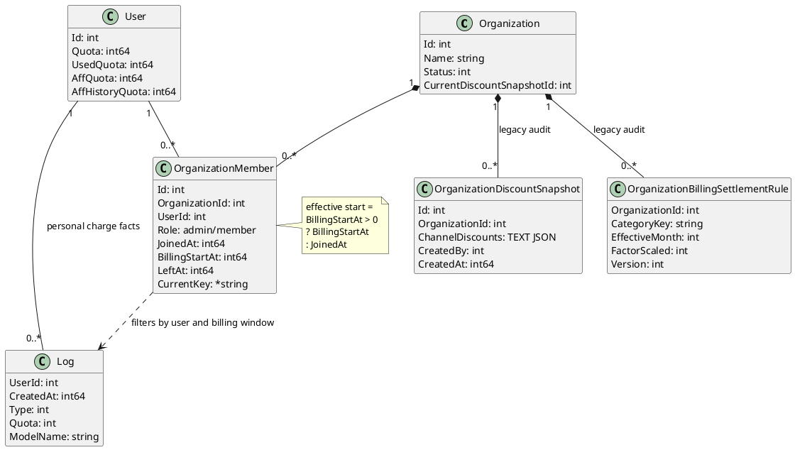

# 数据模型

组织查询、接口和日志聚合细节见 [组织与组织账单架构设计](./组织与组织账单架构设计.md)。

基础组织与 Billing 数据模型已随产品上线；本文记录组织、历史归属起点、Invoice 汇总和退役定价数据的存储职责。目标环境验证与发布状态见[路线图](../50-planning/路线图.md#organization-release)。实时消费规则的阶段、读模型与快照见[实时模型折扣架构](用户与组织实时模型折扣架构设计.md)。

## 额度数值类型

系统区分三类 quota 的 Go 类型、数据库类型和边界，避免把“钱包容量”与“单次计费上限”混用：

| 类型 | 含义 | Go 类型 | 数据库类型 | 边界 |
| --- | --- | --- | --- | --- |
| Charge quota | 单次请求预估、预扣、结算、退款、单条消费日志 | `int` | `INT` | 饱和到 `math.MaxInt32`（即 `common.MaxQuota`） |
| Balance quota | 用户钱包、API Key 剩余/已用额度、邀请额度、调额流水、充值/兑换码额度 | `int64` | `BIGINT`（SQLite 为 `INTEGER`） | `common.MinWalletQuota`（`math.MinInt32`）至 `common.MaxWalletQuota`（`500_000_000_000_000`） |
| Aggregate quota | 账单、Invoice、统计的 `SUM` 结果 | `int64` | 聚合结果按 `int64` 接收 | 每次累加检查溢出 |

- `common.QuotaFromFloatChecked` / `QuotaRoundChecked` / `QuotaFromDecimalChecked` 用于 charge quota 转换，返回 `int`，保持 `MaxInt32` 饱和与审计不变量。
- `common.QuotaBalanceFromDecimalStrict` 用于向钱包或 API Key 发放额度：先截断到整数，再按调用方指定的 `[min, max]` 拒绝；越界时返回错误，不饱和发放。
- 余额调整优先在同一数据库操作中使用 `WHERE` 范围谓词或 `lockForUpdate(tx)`，使边界检查与算术原子化。
- Redis 用户缓存 `UserBase.Quota` 为 `int64`，`userCacheSchemaVersion` 以 `model/user_cache.go` 为准；版本不匹配时回源主库，且不得用可能滞后的快照覆盖 Redis 中的原子 quota 增量。
- 数据库迁移由 `model/quota_balance_bigint_migration.go` 统一执行：幂等地将 MySQL/PostgreSQL 的相关列从 `INT` 扩到 `BIGINT`，SQLite 无需改列；启动时 `verifyQuotaBalanceSchema()` 检查所有列已是 64 位。

## 个人账单主体

现有个人账号仍是真实扣费主体：

- `users.quota`：个人剩余额度，`int64` / `BIGINT`，受 `common.MinWalletQuota` 与 `common.MaxWalletQuota` 限制。
- `users.used_quota`：个人已用额度，`int64` / `BIGINT`。
- `users.aff_quota` / `users.aff_history_quota`：邀请剩余/历史额度，`int64` / `BIGINT`。
- `users.request_count`：个人请求次数。
- `users.group`：用户分组、模型可用性、路由和倍率维度，不是组织。
- `tokens.user_id`：Token 归属个人用户。
- `logs.user_id`：消费事实归属个人用户。

组织扩展不改变这些字段的语义。

## 组织模型

组织只表达组织空间、成员关系、角色和报表权限。

```go
type Organization struct {
    Id                         int
    Name                       string
    Status                     int
    CurrentDiscountSnapshotId  int    // 旧渠道折扣快照指针，0 表示历史未配置
    CreatedAt                  int64
    UpdatedAt                  int64
}

type OrganizationMember struct {
    Id             int
    OrganizationId int
    UserId         int
    Role           string // admin / member
    JoinedAt       int64
    LeftAt         int64  // 0 表示当前仍有效
    BillingStartAt int64  // 0 表示兼容旧行，读取时回退 JoinedAt
    CurrentKey     *string // 活动关系保存用户 ID，历史关系为 NULL
}

type OrganizationBillingSettlementRule struct {
    Id             int
    OrganizationId int
    CategoryKey    string
    EffectiveMonth int // 北京时间 YYYYMM
    FactorScaled   int // 结算系数 × 10,000
    Version        int
    CreatedAt      int64
    UpdatedAt      int64
}

type OrganizationDiscountSnapshot struct {
    Id               int    // 主键及历史顺序
    OrganizationId   int    // 普通索引
    ChannelDiscounts string // TEXT JSON，键为渠道 ID，值为定点整数倍率
    CreatedBy        int
    CreatedAt        int64
}
```

`OrganizationMember` 是用户加入组织的唯一事实来源。`users` 表不增加当前组织字段，Token、Header、请求参数和 `group` 都不表达组织归属。

创建组织只创建 `Organization`，不创建成员关系。系统管理员后续通过成员接口添加 Admin 或 Member。

### 关系图



## 组织渠道折扣快照

`organization_discount_snapshots` 和 `organizations.current_discount_snapshot_id` 保留供历史核账。`ChannelDiscounts` 以 `TEXT` 保存渠道 ID 到百万分制定点倍率的 JSON 映射。旧配置管理接口已退役，新请求不读取该表。已提交的旧异步任务使用自身保存的倍率快照结算。历史结构与退役边界见 [ADR-0002](./decisions/0002-组织渠道折扣.md) 和 [ADR-0004](./decisions/0004-退役组织渠道折扣与月度结算系数.md)。

## 成员关系约束

- 一个用户同一时间只能属于一个组织。
- 当前有效成员使用 `left_at = 0` 表达。
- 新成员由业务代码写入 `billing_start_at = joined_at`；功能上线前的旧行保留零值并在读取时回退 `joined_at`，避免迁移后账单自动变化。
- `joined_at` 是成员关系审计事实，`billing_start_at` 是组织报表归属起点，两者不得混用。
- 添加成员必须在事务中检查该用户没有其他 `left_at = 0` 的成员关系。
- `current_key` 可空唯一索引处理并发竞争，不依赖跨数据库部分索引。
- 组织可以处于无成员状态，此时只有系统管理员能继续维护该组织。
- 移除成员设置 `left_at`，不物理删除成员关系。
- 当前操作者可以移除自己，但移除或降级后必须至少保留一个活动 Admin。
- 添加、移除和角色变更通过组织行锁串行化，并在同一事务中维护最后一个 Admin 不变量。

跨数据库约束不能依赖部分索引。SQLite、MySQL、PostgreSQL 通过事务检查和 `current_key` 可空唯一索引共同保证当前有效成员唯一性。

历史归属起点只能显式向前调整。应用时锁定组织和当前成员记录，校验 `expected_billing_start`、候选时间及同组织内该用户其他成员窗口不重叠；跨组织窗口允许重叠。该限制防止同一日志在同组织的多段关系中重复统计。

## 组织账单口径

组织账单从现有个人消费日志聚合，不新增独立组织流水表。

```text
Organization
  -> OrganizationMember.UserId
  -> Log.UserId
  -> group by member / model / channel / time
```

成员有效期过滤规则：

- `effective_billing_start = billing_start_at > 0 ? billing_start_at : joined_at`
- `Log.CreatedAt >= effective_billing_start`
- `OrganizationMember.LeftAt = 0` 或 `Log.CreatedAt < OrganizationMember.LeftAt`

查询需要兼容主库日志、独立日志库和 ClickHouse 场景，不能假设组织表与日志表可以跨库 join。实现上先从主库读取成员及有效期，再到日志库按 `user_id`、时间窗口、日志类型、模型和渠道过滤。

管理员直接调额使用主库 `UserQuotaAdjustment` 记录不可变财务事实：`delta_quota`、`balance_before`、`balance_after` 均为 `int64`，保存增加/扣减/覆盖产生的有符号余额变化和事务前后余额；`mode` 保存操作方式，`operator_user_id` 保存操作者。该记录与 `users.quota` 更新在同一事务提交，Invoice 按 `user_id + created_at` 索引汇总账期净额。

## Invoice 派生汇总与财务事实字段

Invoice 月度账单使用“原始事实是真相、派生汇总是缓存”的两层数据结构，生成流程见 [组织与组织账单架构设计](./组织与组织账单架构设计.md)。

汇总 payload 可按计算版本重建。下表同时列出持久基线和历史调额事实。

| 表 | 唯一键 | 职责 |
| --- | --- | --- |
| `organization_invoice_period_summaries` | `organization_id + period_start + period_end + calculation_version` | 按期间保存原子发布的二进制 payload（账户财务 DTO、模型用量 DTO、截止点）；`status` 为 `building / ready / failed / invalidated`，`revision` 条件更新防并发重建；计算版本见[组织账单架构](组织与组织账单架构设计.md#按需月度汇总) |
| `organization_invoice_baselines` | `organization_id` | 组织账务起算月 |
| `organization_invoice_account_baselines` | `organization_id + user_id` | 每个账户在起算月的真实期初额度，由后台回放起算月前已识别事实构建，只在缺失时写入 |
| `user_quota_adjustment_legacy_facts` | 源管理日志 ID | 上线前旧管理员调额的人工复核事实，可选固化、幂等；不是查账前置 |

支撑财务闭合的结构化事实字段（主库）：

- `topups.credited_quota`：`int64`，充值实际入账 quota，Stripe、Epay、Creem、Waffo、Waffo Pancake 和管理员补单在实际入账时写入；`default:0` 保证存量表可迁移。旧订单只允许通过显式提供并复核账期 `QuotaPerUnit` 的 CLI 幂等回填，不用当前配置反推历史额度。
- `logs.billing_source`：`varchar(32)`，消费/退款日志的资金来源；新日志默认钱包来源，订阅来源不进入钱包扣减。旧日志在结构化列为空时由惰性汇总兼容读取 `Other.billing_source`。
- `subscription_orders.charged_quota`：`int64`，钱包购买订阅的实际扣减，归入“其他扣减”；旧订单只兼容读取精确的 `charged_quota=<整数>` 文本并标记 `incomplete`。
- 财务计算全部使用 `int64 quota`，最后才换算 USD 字符串；负数总入账、负数总扣减或溢出直接标记 `incomplete`，失败汇总不发布。

## 组织结算规则

`organization_billing_settlement_rules` 保留旧规则，使用 `organization_id + category_key + effective_month` 唯一定位，倍率按万分制定点保存。当前 Invoice 构建、读取和导出均按已确认的实际消费额度汇总。

`organization_invoice_period_summaries.rule_recalc_payload` 保存仍待重新认领的旧重算输入。重新认领时同一条件更新将原始字节转存到 `legacy_rule_publication`、清空旧负载并递增修订。`legacy_rule_publication` 随启动迁移新增，属于历史核账资料。清理派生汇总时须保全审计记录。

## 睿观受管接合的数据责任

已接入的套餐操作回执与金额换算快照见[睿观模型服务设计](睿观模型服务接合设计.md#数据与控制流)。复用原生财务事实，仅补缺少的可追溯元数据；v2 wire schema 与主库持久模型分开，也不新增组织／员工钱包。原生 quota 类型和范围沿本文及计费规则。

## 定价、分销与统计扩展

| 领域 | 主库事实与派生数据 | 细节 |
| --- | --- | --- |
| 实时模型折扣 | 主体配置头、规则、历史与全局迁移阶段 | [实时定价数据模型](用户与组织实时模型折扣架构设计.md#数据模型) |
| 代理分销 | 固定归属、额度调整、请求与事件是持久事实；采购余额及占用可从事件投影 | [代理分销数据模型](代理分销与用户专属倍率架构设计.md#数据模型) |
| 组织统计 | 用量切片、快照和 Invoice 汇总 payload 可重建；源消费、资金记录和历史审计资料独立保留 | [组织聚合实现](组织与组织账单架构设计.md#聚合实现) |

## 明确不建模

已上线版本明确不引入：

- 组织余额。
- 组织充值。
- 组织订阅。
- 组织付款客户 ID。
- 组织级资金路径：组织折扣只是计价乘数，预扣、补扣、结算、退款始终走用户自身的 `BillingSession` 与钱包/订阅。
- 组织 API Key。
- Token 与组织绑定。
- 请求 Header 或请求参数中的组织归属。
- 独立 `OrganizationUsage` 流水。
- 中心化钱包总账：每条余额变动必须能定位到结构化业务事实（充值订单、调额流水、消费/退款日志、订阅订单），Invoice 派生汇总不升级为权威流水。
- 组织全局倍率、免费倍率 `0`、折扣草稿、预约生效与归档/恢复生命周期。
